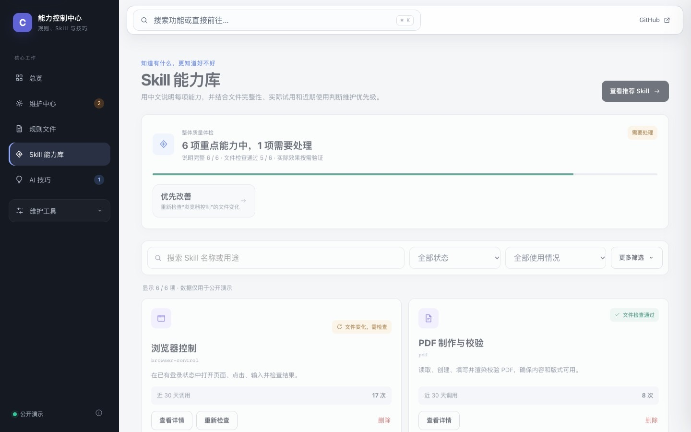

# Codex 能力控制中心

> Public V4.24.0 · 公开交互演示

把 Codex 的规则、Skill 与 AI 技巧，从“装完就忘”变成可判断、可维护、可验证的工作流。

这是一个本地优先的能力维护工具：发现变化，核对证据，由你决定，再验证结果。每个待办都回答四件事——为什么出现、系统建议什么、你能做什么、完成后怎样确认。

**[立即体验公开演示](https://suijie.github.io/codex-capability-center/)**

## 你可以体验什么

- 在原页面完成规则复核和 Skill 推荐安装演示
- 查看推荐的用途、适用场景、来源边界与风险
- 搜索、筛选、查看近 30 天调用并确认删除 Skill
- 浏览、收藏或标记已掌握的 AI 使用技巧
- 用全局搜索快速找到页面与功能
- 在桌面和手机上使用响应式导航

演示页面使用纯虚构数据，按钮只改变当前页面状态，不读取或修改访客设备，也不发出网络请求。模拟安装成功、质量分和热度都不能证明真实效果。

## 产品结构

1. **总览**：只看待处理事项和核心状态。
2. **维护中心**：判断建议，查看复盘和扫描结果。
3. **规则文件**：复核被明确标色的变化。
4. **Skill 能力库**：查看用途、质量状态、近期调用和维护动作。
5. **AI 技巧**：按需浏览可信方法，不把信息推荐变成待办。

安装、检查、历史、备份和环境排查属于二级维护工具，不额外占用主导航。

## 重要边界

本页是 V4.24.0 的安全交互子集，不是完整本地管理台。来源与方法绑定、旧证据降级、真实周复盘、历史追溯、后台任务恢复、真实来源扫描以及本机文件操作尚未在公开页演示；完整本地管理台不在公开仓库中。预览图已对照当前版本并完成发布前复核，仅用于说明公开演示界面，不代表真实数据或实际效果。

任何规则修改、Skill 安装或删除，在完整产品中都需要明确确认。GitHub 热度只是参考，不等于质量；文件检查通过也不等于真实任务效果。

## 隐私与项目边界

- 公开仓库仅包含白名单演示文件、虚构数据和 MIT 许可证。
- 不包含个人规则、真实 Skill 内容、使用记录、本机路径、账号信息或本地服务。
- 本项目为非官方个人项目，与 OpenAI 不存在隶属或背书关系。Codex 与 OpenAI 是其各自权利人的商标。

## 版本与构建

- 公开版：Public V4.24.0
- 对齐产品：V4.24.0，构建 2026.10.12.01
- 演示基线：V4.24.0（仅部分流程）
- 发布日期：2026-10-13
- 在线公开演示：GitHub Pages
- 技术形态：无依赖、无网络请求的单文件静态演示

`manifest.json` 记录公开源文件、功能范围和 SHA-256 摘要；它不会把公开演示冒充为完整产品。构建与发布前需重新执行隐私扫描、浏览器验收和目标核对。

如果这个项目帮你把 Codex 能力从“库存”变成“有据可查”，欢迎点一个 **Star**。发现流程不清或关键场景缺失，欢迎[提交 Issue](https://github.com/suijie/codex-capability-center/issues)。

## License

[MIT](LICENSE)
